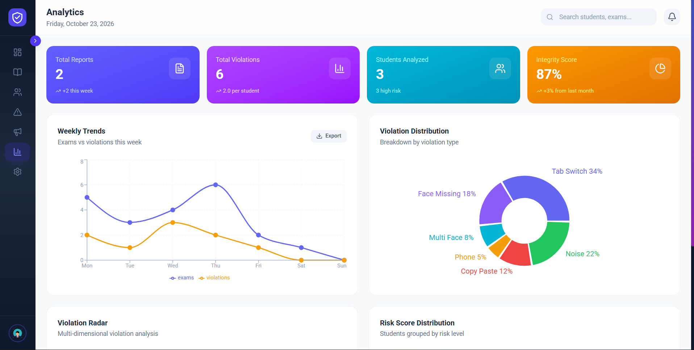
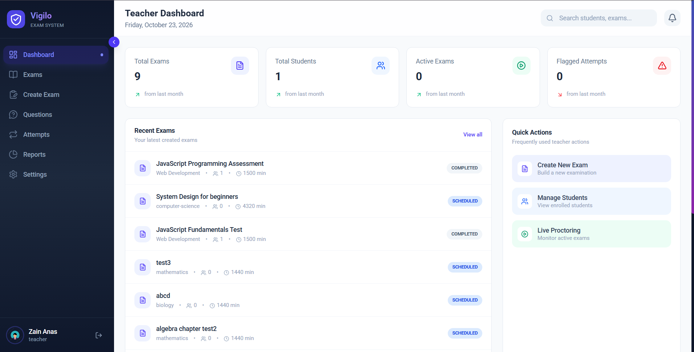
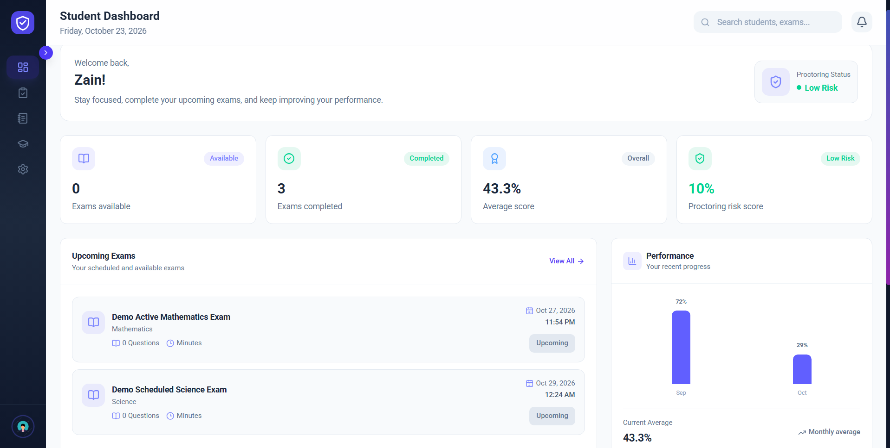

# Vigilo Proctoring System

Vigilo is an AI-powered online examination and proctoring platform for secure remote assessments. It supports administrators, teachers, and students with exam management, question banks, timed examinations, face verification, webcam and screen monitoring, suspicious-activity detection, violation tracking, analytics, reports, and result management.

> **Architecture note:** The project is described as a MERN application, but it also contains a separate Django/Python AI service. The complete architecture is React + Vite, Node.js + Express, MongoDB + Mongoose, and Django REST Framework for computer-vision features.

## Features

- User registration and login
- JWT-based authentication
- Password recovery and reset flow
- Role-based access control
- Admin, teacher, and student dashboards
- Exam creation and management
- Question and question-bank management
- Timed online examinations
- Automatic exam submission on expiration
- Face detection and face verification
- Webcam, microphone, and screen monitoring
- Suspicious activity detection
- Realtime proctoring events using Socket.IO
- Violation recording and review
- Student attempts and result tracking
- Analytics dashboards
- Teacher reports
- PDF report-generation support
- Notifications
- Light and dark themes
- Responsive layouts
- Toast notifications and animated UI transitions

## Technology Stack

### Frontend

- React 19
- Vite
- React Router
- Tailwind CSS
- Axios
- Socket.IO Client
- Framer Motion
- Chart.js
- Recharts
- jsPDF
- jsPDF AutoTable
- Lucide React
- React Icons
- React Hot Toast

### Backend

- Node.js
- Express 5
- MongoDB
- Mongoose
- JSON Web Tokens
- bcryptjs
- Socket.IO
- Zod
- Multer
- Nodemailer
- Helmet
- CORS
- Express Rate Limit
- Morgan
- dotenv

### AI Service

- Python
- Django
- Django REST Framework
- OpenCV
- MediaPipe
- NumPy
- InsightFace
- ONNX Runtime
- django-cors-headers
- python-dotenv

## Application Roles

### Administrator

Administrators can:

- View platform analytics
- Manage users and students
- Manage exams
- Monitor live examinations
- Review violations
- Inspect attempts
- View reports and statistics
- Manage application settings

### Teacher

Teachers can:

- Create and manage exams
- Add and edit questions
- Maintain a question bank
- View student attempts
- Review exam performance
- Generate reports
- Manage teacher settings

### Student

Students can:

- View available exams
- Read exam instructions
- Perform system checks
- Complete face verification
- Take timed examinations
- Submit answers
- View results
- Review previous attempts
- Manage student settings

## Pages and Routes

### Public Pages

| Route | Description |
|---|---|
| `/` | Landing page |
| `/features` | Product features |
| `/how-it-works` | Examination and proctoring workflow |
| `/security` | Security information |
| `/about` | About Vigilo |

### Authentication Pages

| Route | Description |
|---|---|
| `/login` | User login |
| `/register` | User registration |
| `/forgot-password` | Password recovery |
| `/reset-password/:token` | Password reset |

### Administrator Pages

| Route | Description |
|---|---|
| `/admin` | Administrator dashboard |
| `/admin/dashboard` | Administrator dashboard |
| `/admin/exams` | Exam management |
| `/admin/exams/:examId/live-monitor` | Live exam monitoring |
| `/admin/students` | Student and user management |
| `/admin/violations` | Violation review |
| `/admin/attempts` | Exam attempts |
| `/admin/analytics` | Analytics dashboard |
| `/admin/settings` | Administrator settings |

### Teacher Pages

| Route | Description |
|---|---|
| `/teacher` | Teacher dashboard |
| `/teacher/dashboard` | Teacher dashboard |
| `/teacher/exams` | Teacher exam list |
| `/teacher/create-exam` | Create an exam |
| `/teacher/exams/:examId/questions` | Questions for a specific exam |
| `/teacher/question-bank` | Question bank |
| `/teacher/attempts` | Student attempts |
| `/teacher/reports` | Reports |
| `/teacher/settings` | Teacher settings |

### Student Pages

| Route | Description |
|---|---|
| `/student` | Student dashboard |
| `/student/dashboard` | Student dashboard |
| `/student/exam` | Exam redirect page |
| `/student/exam-list` | Available exams |
| `/student/exam/:examId` | Examination page |
| `/student/exam/:examId/instructions` | Exam instructions |
| `/student/exam/:examId/system-check` | System requirements check |
| `/student/exam/:examId/face-verification` | Face verification |
| `/student/exam/:examId/start` | Start or continue an exam |
| `/student/exam/:examId/thank-you` | Submission confirmation |
| `/student/prev-result` | Previous results |
| `/student/setting` | Student settings |

### Common Pages

| Route | Description |
|---|---|
| `/unauthorized` | Unauthorized access page |
| `*` | Not found page |

## Project Overview

## Admin Analytics


## Teacher Dashboard


## Student Dashboard



## Student Examination Flow

```text
Student Dashboard
      |
      v
Available Exams
      |
      v
Exam Instructions
      |
      v
System Check
      |
      v
Face Verification
      |
      v
Start Examination
      |
      v
Answer Questions
      |
      v
Submit or Auto-submit
      |
      v
Thank-you Page
      |
      v
View Results and Previous Attempts
```

## System Architecture

```text
React + Vite Client
        |
        | REST API using Axios
        | Realtime events using Socket.IO
        v
Node.js + Express Backend
        |
        | Mongoose
        v
MongoDB

Node.js Backend
        |
        | Axios + X-Service-Key
        v
Django REST AI Service
        |
        +-- Face detection
        +-- Face enrollment
        +-- Face embedding extraction
        +-- Face verification
```

The frontend is initialized in `client/src/main.jsx` with:

- `BrowserRouter`
- `ThemeProvider`
- `AuthProvider`
- `react-hot-toast`

Frontend routes are defined in:

```text
client/src/App.jsx
client/src/routes/AdminRoutes.jsx
client/src/routes/TeacherRoutes.jsx
client/src/routes/StudentRoutes.jsx
```

The Express backend is configured in:

```text
server/app.js
server/server.js
```

The backend provides REST APIs, connects to MongoDB, and starts the Socket.IO server.

The AI service is implemented inside `AIService/` and is called by the backend through:

```text
server/services/aiClient.js
```

## Repository Structure

```text
AIService/
  config/                 Django configuration
  proctoring/
    services/
      face_detection.py   Face detection
      face_recognition.py Face embeddings and comparison
      image_utils.py      Image decoding and validation
    views.py              AI API endpoints
    urls.py               AI URL mappings
  manage.py               Django management entry point
  requirements.txt        Python dependencies
  db.sqlite3              Development SQLite database

client/
  src/
    App.jsx               Main frontend routes
    main.jsx              React entry point
    Layout/               Admin, teacher, and student layouts
    components/           Reusable UI and proctoring components
    context/              Authentication and theme contexts
    guards/               Protected route guards
    hooks/                Custom React hooks
    pages/                Public, authentication, admin, teacher, and student pages
    routes/               Role-specific routes
    services/             API service modules
    constant/             Application constants and roles
    data/                 Frontend data
    assets/               Frontend assets
    index.css             Global styles
  public/                 Public static files
  package.json            Frontend dependencies and scripts
  vite.config.js          Vite configuration

server/
  app.js                  Express application setup
  server.js               HTTP server and database startup
  config/                 Database and environment configuration
  controllers/            Request controllers
  middleware/             Authentication, errors, validation, and rate limiting
  models/                 Mongoose models
  routes/                 REST API routes
  services/               Business logic and AI integration
  socket/                 Socket.IO setup and events
  utils/                  Error, logging, and utility modules
  validators/             Validation schemas
  postman/                API testing resources
  .env.example            Backend environment template

web-photo/
  screenshot-fullpage-*.png  Application screenshots

color pallatte.txt           Design palette
```

## Backend Models

The backend uses Mongoose models for:

- `User`
- `Exam`
- `Question`
- `Attempt`
- `Violation`
- `Report`
- `Notification`

An exam attempt stores:

- Student and exam references
- Start time
- Submission time
- Expiration time
- Answers
- Score
- Total marks
- Percentage
- Pass/fail status
- Correct answers
- Wrong answers
- Unattempted questions
- Violation count
- IP address
- User agent

Supported attempt statuses are:

```text
in_progress
submitted
auto_submitted
expired
```

## Proctoring and Violations

The system supports the following violation types:

```text
TAB_SWITCH
FULLSCREEN_EXIT
FACE_NOT_DETECTED
MULTIPLE_FACES
PHONE_DETECTED
NOISE_DETECTED
SCREEN_SHARE_STOPPED
COPY_PASTE
SUSPICIOUS_MOVEMENT
CAMERA_DISABLED
MICROPHONE_DISABLED
CONNECTION_LOST
FACE_MISMATCH
```

Supported severity levels:

```text
low
medium
high
critical
```

Each violation can store:

- Attempt
- Exam
- Student
- Violation type
- Severity
- Description
- Timestamp
- Metadata
- Review status
- Reviewer
- Review time
- Review note

## Realtime Socket Events

The Socket.IO implementation supports:

```text
join:exam
leave:exam
proctor:event
proctor:heartbeat
proctor:heartbeat:ack
```

The system uses authenticated exam and attempt rooms:

```text
exam:<examId>
attempt:<attemptId>
```

Realtime functionality includes:

- Student heartbeats
- Exam-room membership
- Proctoring-event transmission
- Violation creation
- Connection monitoring
- Heartbeat acknowledgements

## AI Service

The Django AI service provides the following endpoints:

| Method | Endpoint | Description |
|---|---|---|
| `GET` | `/api/ai/health/` | AI service health check |
| `POST` | `/api/ai/face-detection/` | Detect faces in an image |
| `POST` | `/api/ai/face/enroll/` | Create a face embedding |
| `POST` | `/api/ai/face/verify/` | Verify a live face against a reference |

Face detection can return:

```text
no_face
single_face
multiple_faces
```

The AI service can:

- Detect faces
- Identify multiple faces
- Extract face embeddings
- Compare face embeddings
- Verify student identity
- Reject invalid or empty images

When configured, requests to the AI service are protected using:

```text
X-Service-Key
```

## Backend API Areas

The Express API is mounted under `/api`:

```text
/api/auth
/api/users
/api/exams
/api/questions
/api/attempts
/api/results
/api/violations
/api/notifications
/api/analytics
/api/reports
/api/ai
```

Backend health endpoint:

```text
GET /health
```

## Environment Variables

Create a `.env` file inside `server/` using `.env.example`:

```dotenv
NODE_ENV=development
PORT=5000
MONGODB_URI=mongodb://127.0.0.1:27017/vigilo
JWT_SECRET=change_me_to_a_long_random_string
JWT_EXPIRES_IN=7d
CLIENT_URL=http://localhost:5173
AI_SERVICE_URL=http://localhost:8000
AI_SERVICE_KEY=
FACE_MATCH_THRESHOLD=0.6
```

Required backend variables:

```text
MONGODB_URI
JWT_SECRET
```

## Installation and Running

The project runs as separate frontend, backend, AI, and database services.

### Prerequisites

- Node.js
- npm
- Python 3
- pip
- MongoDB
- Browser camera and microphone permissions

### 1. Start MongoDB

Start MongoDB locally or use a remote MongoDB instance.

The default local database URL is:

```text
mongodb://127.0.0.1:27017/vigilo
```

### 2. Start the backend

```bash
cd server
npm install
cp .env.example .env
npm run dev
```

On Windows PowerShell:

```powershell
cd server
npm install
Copy-Item .env.example .env
npm run dev
```

The backend runs on:

```text
http://localhost:5000
```

### 3. Start the AI service

```bash
cd AIService
python -m venv .venv
```

Activate the virtual environment.

macOS/Linux:

```bash
source .venv/bin/activate
```

Windows PowerShell:

```powershell
.venv\Scripts\Activate.ps1
```

Install dependencies and start Django:

```bash
pip install -r requirements.txt
python manage.py runserver 8000
```

The AI service runs on:

```text
http://localhost:8000
```

### 4. Start the frontend

```bash
cd client
npm install
npm run dev
```

The frontend runs on:

```text
http://localhost:5173
```

## Available Scripts

### Frontend

Run these commands inside `client/`:

```bash
npm run dev       # Start Vite development server
npm run build     # Build production frontend
npm run preview   # Preview production build
npm run lint      # Run ESLint
```

### Backend

Run these commands inside `server/`:

```bash
npm run dev       # Start backend with nodemon
npm start         # Start backend with Node.js
npm test          # Placeholder test command
```

### AI Service

Run these commands inside `AIService/`:

```bash
python manage.py runserver 8000
python manage.py check
python manage.py migrate
```

## Security

The project includes:

- JWT authentication
- Password hashing using bcryptjs
- Role-based protected routes
- Helmet security headers
- CORS configuration
- Express rate limiting
- Environment-variable validation
- Zod request validation
- Centralized error handling
- Authenticated Socket.IO connections
- AI-service key authentication
- Configurable face-match threshold
- MongoDB persistence for examination data

## Design System

The interface uses an indigo and purple visual theme.

### Light Mode

```text
Background: White
Cards: White
Text: Slate
Primary: #6366F1
```

### Dark Mode

```text
Background: #0F172A
Cards: #1E293B
Sidebar: #111827
Text: #F8FAFC
Secondary text: #94A3B8
Primary: #818CF8
```

## Current Project Notes

- The root `package.json` is empty.
- Frontend and backend dependencies must be installed separately.
- The original `client/README.md` is the default Vite template README.
- Backend tests are not configured yet.
- The project description says MERN, but the AI service is implemented with Django and Python.
- `AIService/db.sqlite3` is used by the Django service during development.
- MongoDB is the primary database for the main application.
- Screenshots are available inside `web-photo/`.
- The repository contains report controller and route filename variants that should be reviewed for duplicate or legacy files.
- The file `color pallatte.txt` documents the project color scheme.

## License

No license file is currently included in the repository.